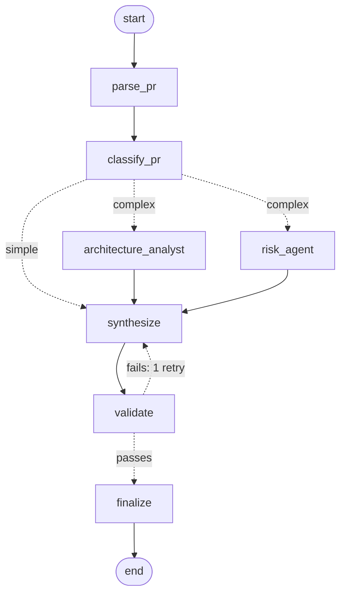

# Intelligent PR Review Assistant

A one-shot command-line tool, built with LangGraph and LangChain on Claude. It reviews **any pull request** given in the assignment's JSON format and writes a structured review: `risk_level`, `risk_reasoning`, `architectural_impact`, `review_focus_areas`, `complexity_score`, `confidence` and `reasoning_trace`. It reads only the PR file: there's no GitHub integration, no repository access and no persistence.

The review of the provided mock PR is in [`code_review_output.json`](code_review_output.json). The full design is in [`docs/PLAN.md`](docs/PLAN.md).

## Quick start

You need **Python 3.12 or newer**. Run every command from the repository root.

```bash
# with pip
python3 -m venv .venv && source .venv/bin/activate   # python3 must be 3.12 or newer
pip install -r requirements.txt          # also installs this project (the `-e .` line)

# or with uv
uv sync

cp .env.example .env                     # then set ANTHROPIC_API_KEY (required) and, optionally, JEV_API_KEY

python analyze_pr.py --pr pr_input.json --output code_review_output.json   # with uv: uv run python analyze_pr.py …
```

| Exit code | Meaning |
|---|---|
| 0 | Full review written |
| 3 | Degraded review written: a stage failed, and the trace says which. If no model review was available, stderr also says it's a rule-based fallback review. |
| 2 | Invalid input (unreadable, over 20 MB, not UTF-8, not JSON, or not the expected format). Nothing is written. |
| 1 | Fatal error: a missing or rejected API key, a bug, or an unwritable output path. In the last case the review is printed to stdout instead. |

**Cost and time** (measured on 2026-11-21; the costs are estimates from list prices): the mock PR took 40 s and ≈ $0.19 (architecture analyst ≈ $0.06, risk agent ≈ $0.09 over 3 calls, synthesis ≈ $0.05). 

## How it works



- **`parse_pr`** (code) validates the input, filters mechanical files (lockfiles, generated code, pure renames), classifies and prioritises each file, scans for secrets and prompt-injection text, and sets the budgets.
- **`classify_pr`** picks a path. **Simple:** one Claude call reviews the small diff directly. **Complex:** an architecture analyst (one call) and a risk agent (a ReAct loop with tools) run in parallel, then `synthesize` merges their findings.
- **`validate`** (code) checks that the draft is grounded: real file paths, a risk level consistent with the verified findings. If it fails, `synthesize` gets one retry with the feedback.
- **`finalize`** (code) computes the complexity score, calibrates the confidence and assembles the output.

**Routing** has three layers ([§3.3](docs/PLAN.md#33-routing-classify_pr)):
1. **Hard rules**, which Jev can't override. Docs- or mechanical-only changes go simple. Core files, new or deleted modules, scan hits, more than 3 code files or more than 50 changed code lines go complex.
2. **Jev**, TypeSafe's decision model, for the uncertain middle only: small code changes the rules can't judge. It returns P(simple), and the PR goes simple only at P ≥ 0.85.
3. **The fallback:** without `JEV_API_KEY`, or on any Jev failure (a timeout after 2 attempts, an error, an unexpected answer), the PR goes **complex**. A missed risk costs more than a few cents of extra review.

**Failures** ([§9](docs/PLAN.md#9-edge-cases--error-handling)):
- A failed analyst is dropped, and the review continues without it, at a capped confidence.
- When no model review is available (synthesis failed, or both analysts did), a deterministic rule-based review is written, with confidence fixed at 0.2. Both cases exit 3.
- A rejected API key or a bug stays fatal (exit 1), so it's never hidden behind "degraded".

## Design choices and trade-offs

**Why LangGraph.** A review here is a workflow, not one prompt: it branches on the PR, runs two analyses at once, loops back once when validation fails, and recovers from a failed stage. All of it shares typed state. LangGraph makes each of those an explicit, testable graph feature instead of hand-wired calls ([§2](docs/PLAN.md#langgraph-features-and-why-each-one-is-used)):

| Feature | Used for |
|---|---|
| Typed state with `operator.add` reducers | Both parallel branches append to the trace and the degraded list safely |
| Conditional edges | The route after `classify_pr`, and retry-or-finish after `validate` |
| Static fan-out and fan-in | The analysts run together, and `synthesize` waits for both. `Send` isn't used: there are always exactly two branches. |
| A bounded cycle | `synthesize ⇄ validate`, with at most 1 retry |
| `RetryPolicy` | Re-running a single-call node only when its output doesn't match the schema |
| Node error handlers with `Command(goto=…)` | Degrading a failed stage and continuing the run |
| A subgraph | The risk agent: `create_agent` returns its own compiled graph |
| Input and output schemas | Callers see `{raw_pr}` in and the review out; everything else stays internal |

**An agent only where exploring pays off.** The risk agent is the only agent. It decides which files to read and what to search, using 4 read-only, bounded tools (`list_changed_files`, `read_file_diff`, `search_diff`, `read_project_context`). It's built with `create_agent`, with only the middleware that solves a real need: tool and model call limits, tool-error handling, refusal handling and prompt caching. The architecture analysis and the synthesis need no exploration, so each is one structured call. Parsing, routing rules, validation and scoring are plain Python: facts are computed in code, and the LLM does the judging.

**Alternatives rejected** ([§2](docs/PLAN.md#alternatives-considered)):
- **A single agent for everything:** simpler, but it mixes responsibilities and its output is harder to validate.
- **A three-lane design with a per-file pre-scan via `Send`:** dropped as over-engineered after a senior engineer's review. The risk agent already reads diffs on demand.
- **A hand-built ReAct loop:** `create_agent` already provides and tests about 150 lines of it.
- **Claude as the router:** it can't give a calibrated probability to threshold on.

**Grounding and confidence.** Every risk finding must quote diff evidence. A finding whose quote isn't in that file's diff loses its "verified" mark and one severity level. Confidence starts from the model's own value, then deterministic penalties and caps apply: unread must-review files, truncated diffs, disagreement between the analysts, a validation retry, core files whose callers aren't in the diff, unverified findings ([§8](docs/PLAN.md#8-synthesize-validate-finalize)). PR content is treated as data, never as instructions.

**Extra libraries and services:**
- **Jev (TypeSafe):** a decision model that returns a probability for one yes/no question, in 0.2–0.7 s for about $0.00003 a call. With `JEV_API_KEY` set, only uncertain-middle PRs are sent to it: the title and description, cut to length, and up to 8,000 characters of code hunks. PRs with a detected secret are never sent. TypeSafe's docs say Jev isn't trained on customer data. They state no retention period, and zero data retention is offered to enterprise customers only.
- **`regex`:** the risk agent's `search_diff` runs model-written patterns over untrusted text, and `regex` adds a timeout that Python's `re` lacks.
- **`httpx`:** the Jev client, with our own timeout and a single retry.
- **`anthropic`:** its error classes decide which failures degrade the review and which are fatal.
- **Pydantic** for every schema, and **python-dotenv** to load `.env`.

## Limitations and what isn't built

- **It sees only the diff:** no code outside it, no test results, no project history ([§4](docs/PLAN.md#4-context-sources--limitations)). Confidence is capped where this matters, and points it can't check become "verify …" focus areas.
- **`complexity_score` measures structure** (size, spread, core files, new modules), not how subtle a change is.
- **The evidence check is a substring match.** It proves the quote exists in the diff, not that the reasoning about it is right. Quotes under 12 characters never count as verified.
- **Tested offline only, never seen on the real API:** a refusal, a schema mismatch after the retry, a 5xx or 429 after the SDK's retries, the agent hitting its step limit, and a failed synthesis retry. If the risk agent fails, the usage it already spent isn't counted.
- **Not built** ([§11](docs/PLAN.md#11-deliberately-not-built)): checkpointing or memory (this is a one-shot CLI; they'd earn their place with follow-up questions, resuming, or human-in-the-loop via `interrupt()`), a vector DB or RAG (the project context is one page; full-repository access would justify it), streaming, and an evaluation set.

## Development

- **Tests:** `uv run pytest` runs offline, with no API key and no network: fake LLMs, a scripted agent model and a mock Jev transport.
- **Dependencies:** after changing `pyproject.toml`, regenerate the pinned list with `uv export --no-dev --no-hashes --format requirements.txt --frozen -o requirements.txt`.
- **Graph diagram:** `uv run python -m agent_workflow.graph` writes `workflow.png`, rendered by the mermaid.ink web service, so it needs network access.
- **Langfuse (optional):** I use a self-hosted Langfuse (in `langfuse/`) for tracing and evaluation while developing. It's turned on only when its keys are set in `.env`, it's not in `requirements.txt`, and the application never needs it.

## How I worked with AI tools

I built this with **Claude Code** (Claude Opus 5.5) as a pair programmer, on a plan-first workflow:
- **Plan before code.** The design was written and revised in [`docs/PLAN.md`](docs/PLAN.md) before implementation. A senior engineer's review cut the first, three-lane design down to the current one.
- **Explicit phases.** Each phase in [`docs/phases.md`](docs/phases.md) got explicit sub-tasks (signatures, rules, expected test values) and open decisions, each with a recommendation and an alternative. I approved or changed every one before any code was written. That file records each decision, review finding and result.
- **Standing rules** for the assistant are in [`CLAUDE.md`](CLAUDE.md) and [`AGENTS.md`](AGENTS.md): no new graph nodes without a plan change, no paid API calls in tests, and never claiming that untested behaviour works.
- **Validating the output.** After each phase, review agents (code review and simplification) checked the work, and I chose which findings to apply. Deliberately broken code (fault injection) confirmed the tests catch real bugs. Small experiments checked library and provider behaviour before the code relied on it: LangGraph's error-handler semantics (offline), Jev's response format and Anthropic's error types (on the real APIs).

### What I already knew, and what was new

Before this project, I had a basic conceptual understanding of LangChain and LangGraph, but very limited practical experience with them. While building it, I got to know their capabilities in much greater depth.

One of the most valuable things I learned was how to trace the workflow at the level of individual nodes: following exactly what happens at each stage, and how the whole workflow progresses. I found this especially useful for debugging, and for understanding the system.
